# Sistema de Gerenciamento de Pedidos (OrderFlow)

> **Objetivo:** Desenvolver uma aplicação simples de gerenciamento de pedidos com **Spring Boot, RabbitMQ, Docker, MySQL** e implantá-la na **AWS**.

---

## Sumário

1. [Visão Geral e Cenário](#1-visão-geral-e-cenário)
2. [Requisitos](#2-requisitos)
3. [Diagrama de Casos de Uso](#3-diagrama-de-casos-de-uso)
4. [Diagrama de Classes](#4-diagrama-de-classes)
5. [System Design da Aplicação](#5-system-design-da-aplicação)
6. [System Design do Banco de Dados](#6-system-design-do-banco-de-dados)
7. [Tecnologias Utilizadas](#7-tecnologias-utilizadas)
8. [Entregáveis](#8-entregáveis)
9. [Próximos Passos: Implantação na AWS](#9-próximos-passos-implantação-na-aws)

---

## 1. Visão Geral e Cenário

A empresa **XYZ** deseja criar uma aplicação para processar pedidos. Os pedidos são recebidos por meio de uma **API REST** e devem ser **processados de forma assíncrona**. A aplicação deve armazenar as informações do pedido em um banco de dados **MySQL** e utilizar a infraestrutura da **AWS**.

---

## 2. Requisitos

### 2.1 Aplicação Spring Boot

| # | Funcionalidade |
|---|----------------|
| RF01 | CRUD de **produtos** (nome, descrição, preço). |
| RF02 | CRUD de **pedidos** (data do pedido, lista de produtos, quantidade, status do pedido). |
| RF03 | Endpoint para **alterar o status** do pedido (`PENDENTE`, `PROCESSANDO`, `CONCLUIDO`). |

### 2.2 Mensageria (RabbitMQ)

| # | Funcionalidade |
|---|----------------|
| RF04 | Ao alterar o status de um pedido, **publicar uma mensagem** no RabbitMQ. |
| RF05 | Um **consumidor** de mensagens deve **atualizar o status** do pedido no banco de dados. |

### 2.3 Banco de Dados (MySQL)

| # | Funcionalidade |
|---|----------------|
| RF06 | Configurar a aplicação para conectar ao MySQL. |
| RF07 | Utilizar **Spring Data JPA** para entidades e persistência. |

### 2.4 Containerização

| # | Funcionalidade |
|---|----------------|
| RF08 | Escrever um **Dockerfile** para a aplicação Spring Boot. |
| RF09 | Criar um **docker-compose.yml** para executar aplicação, RabbitMQ e MySQL. |

### 2.5 Infraestrutura AWS (próximo passo)

| # | Funcionalidade |
|---|----------------|
| RF10 | Implantar a aplicação e dependências na AWS (Amazon ECS, Amazon RDS, etc.). **Planejado como próximo passo**, conforme a [seção 9](#9-próximos-passos-implantação-na-aws). Nesta fase, o escopo cobre o desenvolvimento e a execução local via Docker Compose. |

### 2.6 Endpoints Propostos

| Método | Endpoint | Descrição | Resposta |
|--------|----------|-----------|----------|
| `POST` | `/api/products` | Cria um produto | `201 Created` |
| `GET` | `/api/products` | Lista produtos | `200 OK` |
| `GET` | `/api/products/{id}` | Busca produto por ID | `200 OK` / `404` |
| `PUT` | `/api/products/{id}` | Atualiza um produto | `200 OK` / `404` |
| `DELETE` | `/api/products/{id}` | Remove um produto | `204 No Content` |
| `POST` | `/api/orders` | Cria um pedido (status inicial `PENDENTE`) | `201 Created` |
| `GET` | `/api/orders` | Lista pedidos | `200 OK` |
| `GET` | `/api/orders/{id}` | Busca pedido por ID | `200 OK` / `404` |
| `PUT` | `/api/orders/{id}` | Atualiza itens do pedido | `200 OK` / `404` |
| `DELETE` | `/api/orders/{id}` | Remove um pedido | `204 No Content` |
| `PATCH` | `/api/orders/{id}/status` | Solicita alteração de status (assíncrono) | `202 Accepted` |

---

## 3. Diagrama de Casos de Uso

### 3.1 Visão por Ator

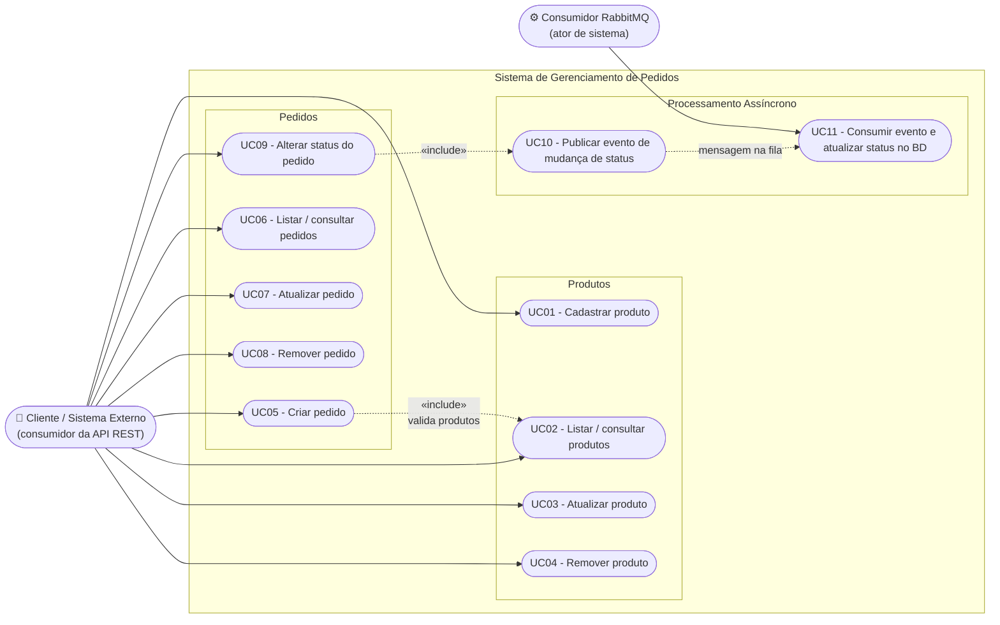

### 3.2 Descrição dos Casos de Uso Principais

| ID | Caso de Uso | Ator | Pré-condição | Fluxo Principal | Pós-condição |
|----|-------------|------|--------------|-----------------|--------------|
| UC01 | Cadastrar produto | Cliente | — | Envia nome, descrição e preço; o sistema valida e persiste. | Produto criado. |
| UC05 | Criar pedido | Cliente | Produtos existentes | Envia lista de itens (produto + quantidade); o sistema valida os produtos, define a data atual, status `PENDENTE` e persiste. | Pedido criado com status `PENDENTE`. |
| UC09 | Alterar status do pedido | Cliente | Pedido existente | Envia o novo status; o sistema valida a transição e publica a mensagem no RabbitMQ; retorna `202 Accepted`. | Mensagem enfileirada. |
| UC10 | Publicar evento | Sistema (Producer) | Status válido | Serializa `OrderStatusMessage` em JSON e envia à exchange. | Mensagem na fila. |
| UC11 | Consumir evento | Consumidor RabbitMQ | Mensagem na fila | Lê a mensagem, busca o pedido, atualiza o status e faz `ack`. | Status atualizado no MySQL. |

### 3.3 Regras de Transição de Status

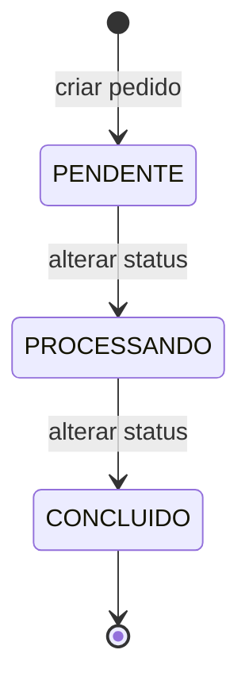

---

## 4. Diagrama de Classes

### 4.1 Visão Completa (por camadas)

```mermaid
classDiagram
    direction TB

    %% ===================== ENTIDADES =====================
    class Product {
        -Long id
        -String name
        -String description
        -BigDecimal price
        -LocalDateTime createdAt
        -LocalDateTime updatedAt
    }

    class Order {
        -Long id
        -LocalDateTime orderDate
        -OrderStatus status
        -LocalDateTime updatedAt
        +addItem(OrderItem item) void
        +removeItem(OrderItem item) void
        +getTotal() BigDecimal
    }

    class OrderItem {
        -Long id
        -Integer quantity
        -BigDecimal unitPrice
        +getSubtotal() BigDecimal
    }

    class OrderStatus {
        <<enumeration>>
        PENDENTE
        PROCESSANDO
        CONCLUIDO
    }

    Order "1" *-- "1..*" OrderItem : possui
    OrderItem "*" --> "1" Product : referencia
    Order --> OrderStatus

    %% ===================== REPOSITORIES =====================
    class JpaRepository~T, ID~ {
        <<interface>>
    }
    class ProductRepository {
        <<interface>>
    }
    class OrderRepository {
        <<interface>>
        +findByStatus(OrderStatus status) List~Order~
    }
    JpaRepository <|-- ProductRepository
    JpaRepository <|-- OrderRepository
    ProductRepository ..> Product
    OrderRepository ..> Order

    %% ===================== SERVICES =====================
    class ProductService {
        +create(ProductRequest) ProductResponse
        +findAll() List~ProductResponse~
        +findById(Long) ProductResponse
        +update(Long, ProductRequest) ProductResponse
        +delete(Long) void
    }
    class OrderService {
        +create(OrderRequest) OrderResponse
        +findAll() List~OrderResponse~
        +findById(Long) OrderResponse
        +update(Long, OrderRequest) OrderResponse
        +delete(Long) void
        +requestStatusChange(Long, OrderStatus) void
        +applyStatusChange(Long, OrderStatus) void
    }
    ProductService --> ProductRepository
    OrderService --> OrderRepository
    OrderService --> ProductRepository
    OrderService --> OrderStatusProducer

    %% ===================== CONTROLLERS =====================
    class ProductController {
        +create() ResponseEntity
        +list() ResponseEntity
        +get(Long) ResponseEntity
        +update(Long) ResponseEntity
        +delete(Long) ResponseEntity
    }
    class OrderController {
        +create() ResponseEntity
        +list() ResponseEntity
        +get(Long) ResponseEntity
        +update(Long) ResponseEntity
        +delete(Long) ResponseEntity
        +changeStatus(Long, StatusRequest) ResponseEntity
    }
    ProductController --> ProductService
    OrderController --> OrderService

    %% ===================== MENSAGERIA =====================
    class OrderStatusMessage {
        <<record>>
        +Long orderId
        +OrderStatus newStatus
        +LocalDateTime occurredAt
    }
    class OrderStatusProducer {
        -RabbitTemplate rabbitTemplate
        +publish(OrderStatusMessage) void
    }
    class OrderStatusConsumer {
        +handle(OrderStatusMessage) void
    }
    class RabbitMQConfig {
        <<configuration>>
        +Exchange orderExchange
        +Queue orderStatusQueue
        +Queue orderStatusDlq
        +Binding binding
        +MessageConverter jsonConverter
    }
    OrderStatusProducer ..> OrderStatusMessage
    OrderStatusConsumer ..> OrderStatusMessage
    OrderStatusConsumer --> OrderService
    RabbitMQConfig ..> OrderStatusProducer
    RabbitMQConfig ..> OrderStatusConsumer

    %% ===================== DTOs =====================
    class ProductRequest {
        <<DTO>>
        +String name
        +String description
        +BigDecimal price
    }
    class ProductResponse {
        <<DTO>>
        +Long id
        +String name
        +String description
        +BigDecimal price
    }
    class OrderRequest {
        <<DTO>>
        +List~OrderItemRequest~ items
    }
    class OrderItemRequest {
        <<DTO>>
        +Long productId
        +Integer quantity
    }
    class OrderResponse {
        <<DTO>>
        +Long id
        +LocalDateTime orderDate
        +OrderStatus status
        +List~OrderItemResponse~ items
        +BigDecimal total
    }
    class StatusRequest {
        <<DTO>>
        +OrderStatus status
    }
    OrderRequest "1" o-- "*" OrderItemRequest

    %% ===================== EXCEÇÕES =====================
    class GlobalExceptionHandler {
        <<ControllerAdvice>>
        +handleNotFound() ResponseEntity
        +handleValidation() ResponseEntity
        +handleInvalidTransition() ResponseEntity
    }
    class ResourceNotFoundException
    class InvalidStatusTransitionException
    RuntimeException <|-- ResourceNotFoundException
    RuntimeException <|-- InvalidStatusTransitionException
    GlobalExceptionHandler ..> ResourceNotFoundException
    GlobalExceptionHandler ..> InvalidStatusTransitionException
```

### 4.2 Visão do Domínio (simplificada)

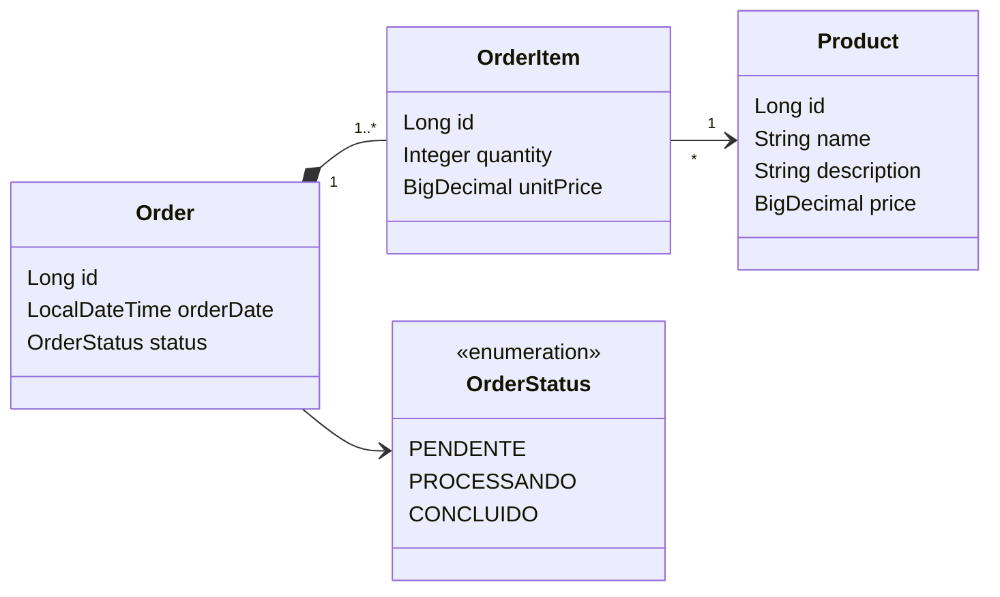

### 4.3 Estrutura de Pacotes Sugerida

```
src/main/java/com/xyz/orders
├── OrdersApplication.java
├── config
│   └── RabbitMQConfig.java
├── controller
│   ├── ProductController.java
│   └── OrderController.java
├── service
│   ├── ProductService.java
│   └── OrderService.java
├── repository
│   ├── ProductRepository.java
│   └── OrderRepository.java
├── domain
│   ├── Product.java
│   ├── Order.java
│   ├── OrderItem.java
│   └── OrderStatus.java
├── dto
│   ├── ProductRequest.java / ProductResponse.java
│   ├── OrderRequest.java / OrderItemRequest.java
│   ├── OrderResponse.java / OrderItemResponse.java
│   └── StatusRequest.java
├── messaging
│   ├── OrderStatusMessage.java
│   ├── OrderStatusProducer.java
│   └── OrderStatusConsumer.java
└── exception
    ├── GlobalExceptionHandler.java
    ├── ResourceNotFoundException.java
    └── InvalidStatusTransitionException.java
```

---

## 5. System Design da Aplicação

### 5.1 Requisitos Não Funcionais

| Categoria | Requisito |
|-----------|-----------|
| **Desacoplamento** | Mudanças de status são processadas de forma assíncrona via fila. |
| **Resiliência** | Mensagens com falha vão para uma **Dead Letter Queue (DLQ)** após *N* tentativas. |
| **Consistência** | Consumidor idempotente (reprocessar a mesma mensagem não gera efeito colateral). |
| **Escalabilidade** | Aplicação *stateless*, preparada para escalar horizontalmente (ex.: no ECS, em etapa futura). |
| **Portabilidade** | Aplicação containerizada, executada via Docker Compose e pronta para ser levada à nuvem. |
| **Observabilidade** | Logs em stdout e endpoint de *health check* (`/actuator/health`). |

### 5.2 Arquitetura de Alto Nível

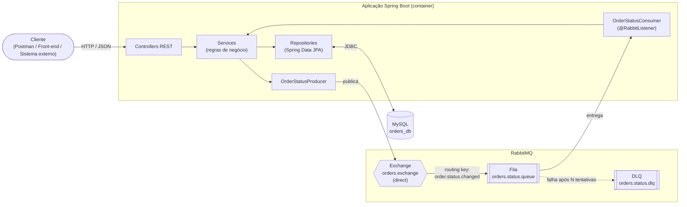

### 5.3 Fluxo: Alteração Assíncrona de Status

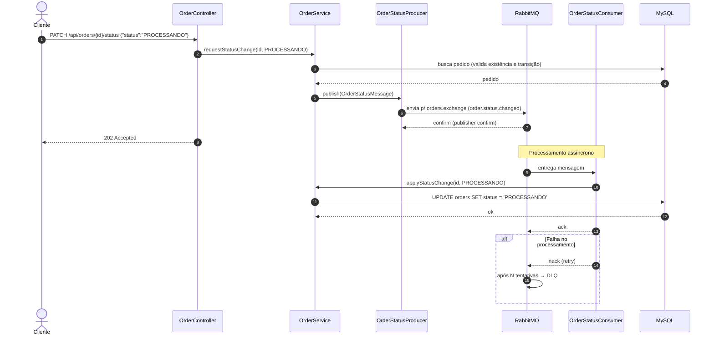

### 5.4 Fluxo: Criação de Pedido

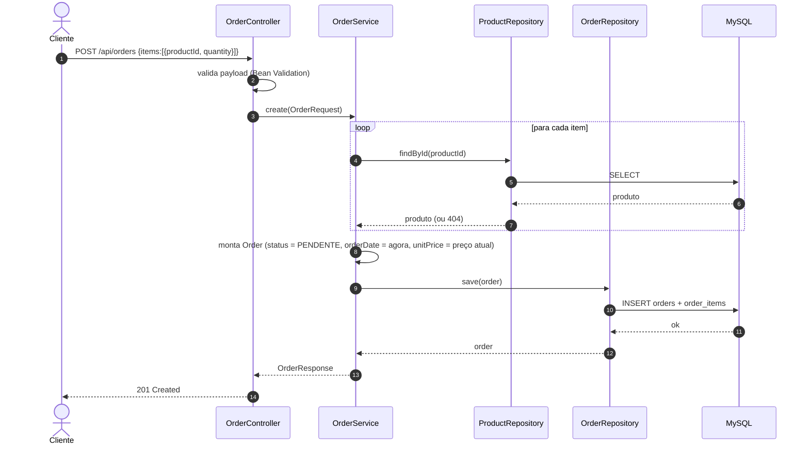

### 5.5 Topologia Local (Docker Compose)

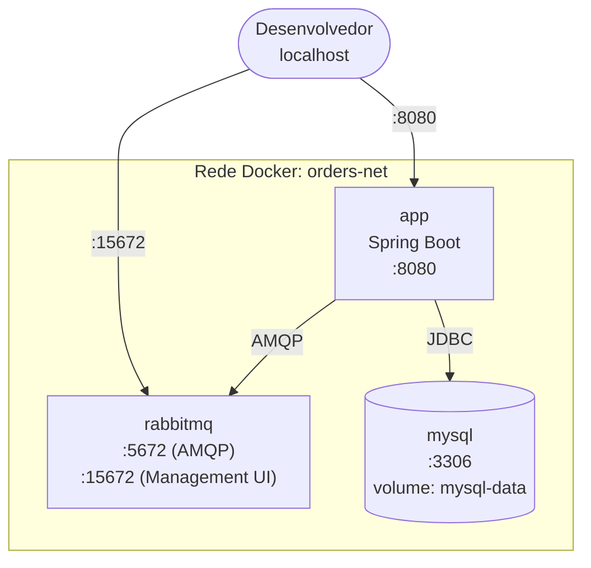

Exemplo de `docker-compose.yml` (referência):

```yaml
services:
  mysql:
    image: mysql:8.0
    environment:
      MYSQL_DATABASE: orders_db
      MYSQL_USER: orders
      MYSQL_PASSWORD: orders123
      MYSQL_ROOT_PASSWORD: root123
    ports: ["3306:3306"]
    volumes: [mysql-data:/var/lib/mysql]
    healthcheck:
      test: ["CMD", "mysqladmin", "ping", "-h", "localhost"]
      interval: 10s
      retries: 10

  rabbitmq:
    image: rabbitmq:3.13-management
    ports: ["5672:5672", "15672:15672"]
    healthcheck:
      test: ["CMD", "rabbitmq-diagnostics", "ping"]
      interval: 10s
      retries: 10

  app:
    build: .
    ports: ["8080:8080"]
    environment:
      SPRING_DATASOURCE_URL: jdbc:mysql://mysql:3306/orders_db
      SPRING_DATASOURCE_USERNAME: orders
      SPRING_DATASOURCE_PASSWORD: orders123
      SPRING_RABBITMQ_HOST: rabbitmq
    depends_on:
      mysql: { condition: service_healthy }
      rabbitmq: { condition: service_healthy }

volumes:
  mysql-data:
```

Exemplo de `Dockerfile` (multi-stage):

```dockerfile
FROM maven:3.9-eclipse-temurin-21 AS build
WORKDIR /app
COPY pom.xml .
RUN mvn dependency:go-offline
COPY src ./src
RUN mvn clean package -DskipTests

FROM eclipse-temurin:21-jre
WORKDIR /app
COPY --from=build /app/target/*.jar app.jar
EXPOSE 8080
ENTRYPOINT ["java", "-jar", "app.jar"]
```

### 5.6 Decisões de Projeto

| Decisão | Justificativa |
|---------|---------------|
| `PATCH` retorna **202 Accepted** | O status só é efetivado após o consumo da mensagem. |
| **Direct Exchange** + routing key | Simples e suficiente para um único tipo de evento. |
| **DLQ** configurada | Evita perda de mensagens e *loop* infinito de reprocessamento. |
| Preço copiado para `order_items.unit_price` | Preserva o histórico caso o preço do produto mude. |
| Consumidor **idempotente** | RabbitMQ garante *at-least-once*; duplicatas são possíveis. |
| DTOs separados das entidades | Evita expor o modelo de persistência e problemas de serialização. |
| Migrações com **Flyway** | Versionamento do schema reprodutível em qualquer ambiente. |

---

## 6. System Design do Banco de Dados

### 6.1 Diagrama Entidade-Relacionamento (ER)

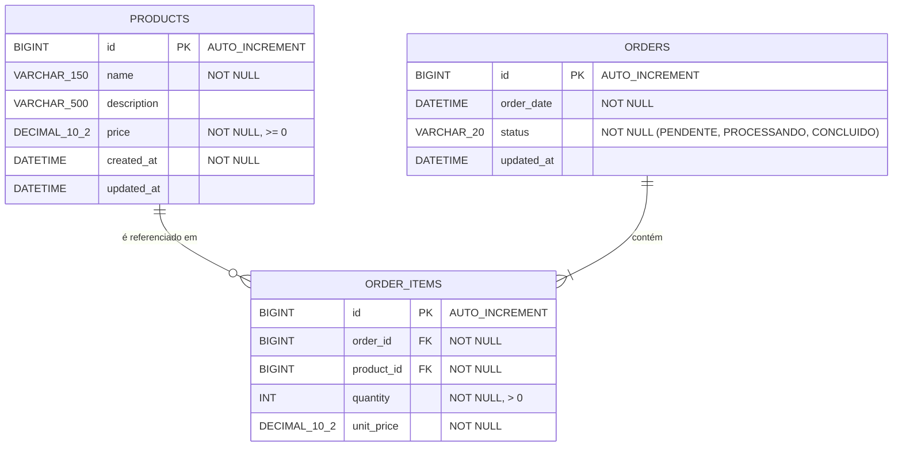

### 6.2 Script DDL (MySQL 8)

```sql
CREATE DATABASE IF NOT EXISTS orders_db
  CHARACTER SET utf8mb4
  COLLATE utf8mb4_unicode_ci;

USE orders_db;

CREATE TABLE products (
    id           BIGINT        NOT NULL AUTO_INCREMENT,
    name         VARCHAR(150)  NOT NULL,
    description  VARCHAR(500)  NULL,
    price        DECIMAL(10,2) NOT NULL,
    created_at   DATETIME      NOT NULL DEFAULT CURRENT_TIMESTAMP,
    updated_at   DATETIME      NULL ON UPDATE CURRENT_TIMESTAMP,
    PRIMARY KEY (id),
    CONSTRAINT chk_products_price CHECK (price >= 0)
) ENGINE=InnoDB;

CREATE TABLE orders (
    id          BIGINT      NOT NULL AUTO_INCREMENT,
    order_date  DATETIME    NOT NULL DEFAULT CURRENT_TIMESTAMP,
    status      VARCHAR(20) NOT NULL DEFAULT 'PENDENTE',
    updated_at  DATETIME    NULL ON UPDATE CURRENT_TIMESTAMP,
    PRIMARY KEY (id),
    CONSTRAINT chk_orders_status
        CHECK (status IN ('PENDENTE', 'PROCESSANDO', 'CONCLUIDO'))
) ENGINE=InnoDB;

CREATE TABLE order_items (
    id          BIGINT        NOT NULL AUTO_INCREMENT,
    order_id    BIGINT        NOT NULL,
    product_id  BIGINT        NOT NULL,
    quantity    INT           NOT NULL,
    unit_price  DECIMAL(10,2) NOT NULL,
    PRIMARY KEY (id),
    CONSTRAINT fk_items_order
        FOREIGN KEY (order_id)   REFERENCES orders(id)   ON DELETE CASCADE,
    CONSTRAINT fk_items_product
        FOREIGN KEY (product_id) REFERENCES products(id) ON DELETE RESTRICT,
    CONSTRAINT chk_items_quantity CHECK (quantity > 0)
) ENGINE=InnoDB;

CREATE INDEX idx_orders_status     ON orders(status);
CREATE INDEX idx_orders_date       ON orders(order_date);
CREATE INDEX idx_items_order       ON order_items(order_id);
CREATE INDEX idx_items_product     ON order_items(product_id);
```

### 6.3 Dicionário de Dados

#### `products`

| Coluna | Tipo | Nulo | Descrição |
|--------|------|------|-----------|
| `id` | BIGINT | Não | Identificador (PK, auto incremento). |
| `name` | VARCHAR(150) | Não | Nome do produto. |
| `description` | VARCHAR(500) | Sim | Descrição do produto. |
| `price` | DECIMAL(10,2) | Não | Preço unitário atual (≥ 0). |
| `created_at` | DATETIME | Não | Data de criação. |
| `updated_at` | DATETIME | Sim | Data da última atualização. |

#### `orders`

| Coluna | Tipo | Nulo | Descrição |
|--------|------|------|-----------|
| `id` | BIGINT | Não | Identificador (PK, auto incremento). |
| `order_date` | DATETIME | Não | Data/hora do pedido. |
| `status` | VARCHAR(20) | Não | `PENDENTE`, `PROCESSANDO` ou `CONCLUIDO`. |
| `updated_at` | DATETIME | Sim | Data da última atualização (ex.: mudança de status). |

#### `order_items`

| Coluna | Tipo | Nulo | Descrição |
|--------|------|------|-----------|
| `id` | BIGINT | Não | Identificador (PK). |
| `order_id` | BIGINT | Não | FK → `orders.id` (cascade). |
| `product_id` | BIGINT | Não | FK → `products.id` (restrict). |
| `quantity` | INT | Não | Quantidade (> 0). |
| `unit_price` | DECIMAL(10,2) | Não | Preço unitário no momento da compra. |

### 6.4 Relacionamentos e Cardinalidades

| Relacionamento | Cardinalidade | Regra |
|----------------|---------------|-------|
| `orders` → `order_items` | 1 : N | Um pedido possui ao menos um item. Excluir o pedido exclui seus itens (`CASCADE`). |
| `products` → `order_items` | 1 : N | Um produto pode estar em vários itens. Não é possível excluir um produto já usado em pedidos (`RESTRICT`). |
| `orders` ↔ `products` | N : N | Resolvido pela tabela associativa `order_items`, que ainda guarda `quantity` e `unit_price`. |

### 6.5 Topologia do Banco

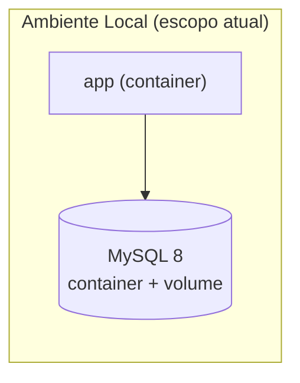

> A topologia do banco na AWS (Amazon RDS) está descrita na [seção 9](#9-próximos-passos-implantação-na-aws).

**Estratégias adotadas:**

- **Migrações:** Flyway (`src/main/resources/db/migration/V1__init.sql`).
- **JPA:** `spring.jpa.hibernate.ddl-auto=validate` em produção (o schema é controlado pelo Flyway).
- **Transações:** `@Transactional` nos services; atualização de status isolada em transação própria no consumidor.
- **Índices:** em `orders.status`, `orders.order_date` e FKs de `order_items`.
- **Persistência local:** volume Docker (`mysql-data`) para manter os dados entre reinicializações.
- **Produção (próximo passo):** RDS Multi-AZ, backups automáticos, criptografia em repouso e acesso restrito via Security Group da aplicação.

---

## 7. Tecnologias Utilizadas

### 7.1 Desenvolvimento da Aplicação

| Categoria | Tecnologia | Uso |
|-----------|-----------|-----|
| **Linguagem** | Java 21 (LTS) | Linguagem principal. |
| **Framework** | Spring Boot 3.x | Base da aplicação. |
| **Web / REST** | Spring Web (Spring MVC) | Controllers e endpoints REST. |
| **Persistência** | Spring Data JPA + Hibernate | Mapeamento objeto-relacional e repositórios. |
| **Mensageria** | Spring AMQP (`spring-boot-starter-amqp`) | Produtor e consumidor RabbitMQ. |
| **Validação** | Spring Validation (Jakarta Bean Validation) | Validação de DTOs. |
| **Observabilidade** | Spring Boot Actuator | Health check e métricas. |
| **Documentação da API** | springdoc-openapi (Swagger UI) | Documentação interativa dos endpoints. |
| **Migração de BD** | Flyway | Versionamento do schema. |
| **Produtividade** | Lombok, MapStruct (opcional) | Redução de boilerplate e mapeamento DTO ↔ entidade. |
| **Build** | Maven (ou Gradle) | Gerenciamento de dependências e build. |

### 7.2 Infraestrutura e Dados

| Categoria | Tecnologia | Uso |
|-----------|-----------|-----|
| **Banco de dados** | MySQL 8 | Armazenamento relacional. |
| **Message Broker** | RabbitMQ 3.x | Fila de eventos de mudança de status. |
| **Containerização** | Docker | Empacotamento da aplicação. |
| **Orquestração local** | Docker Compose | Execução de app + MySQL + RabbitMQ. |

### 7.3 Testes e Qualidade

| Tecnologia | Uso |
|-----------|-----|
| JUnit 5 | Testes unitários. |
| Mockito | Mocks de dependências. |
| Spring Boot Test / MockMvc | Testes de integração dos endpoints. |
| Testcontainers (MySQL + RabbitMQ) | Testes de integração com serviços reais em containers. |
| Postman / Insomnia | Testes manuais da API. |

### 7.4 Ferramentas de Apoio

| Ferramenta | Uso |
|-----------|-----|
| Git / GitHub | Controle de versão. |
| GitHub Actions (opcional) | CI/CD. |
| Mermaid | Diagramas neste documento. |

---

## 8. Entregáveis

| Item | Descrição |
|------|-----------|
| Código-fonte | Projeto Spring Boot (Maven) completo. |
| `Dockerfile` | Build multi-stage da aplicação. |
| `docker-compose.yml` | Orquestra a aplicação, o RabbitMQ e o MySQL. |
| `README.md` | Instruções de execução local (a implantação na AWS será documentada no próximo passo). |
| Documentação (este arquivo) | Casos de uso, classes, system design, modelo de dados e tecnologias. |

### 8.1 Como Executar Localmente (resumo)

```bash
# Subir toda a stack
docker compose up --build -d

# API:               http://localhost:8080
# Swagger UI:        http://localhost:8080/swagger-ui.html
# RabbitMQ Console:  http://localhost:15672  (guest / guest)
```

### 8.2 Exemplo de Uso da API

```bash
# Criar produto
curl -X POST http://localhost:8080/api/products \
  -H "Content-Type: application/json" \
  -d '{"name":"Ração Premium","description":"Saco de 10kg","price":189.90}'

# Criar pedido
curl -X POST http://localhost:8080/api/orders \
  -H "Content-Type: application/json" \
  -d '{"items":[{"productId":1,"quantity":2}]}'

# Alterar status (assíncrono → 202 Accepted)
curl -X PATCH http://localhost:8080/api/orders/1/status \
  -H "Content-Type: application/json" \
  -d '{"status":"PROCESSANDO"}'

# Consultar o pedido após o consumo da mensagem
curl http://localhost:8080/api/orders/1
```

---

## 9. Próximos Passos: Implantação na AWS

> **Status:** planejado. Esta etapa **não faz parte do escopo atual** (desenvolvimento da aplicação e execução local com Docker Compose). Ela descreve como a aplicação será implantada na AWS na sequência.

### 9.1 Arquitetura de Implantação

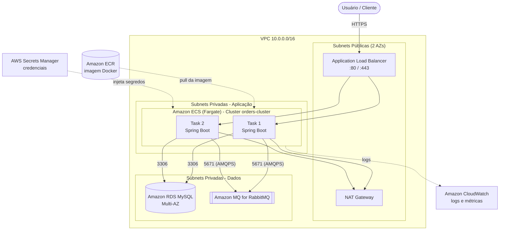

### 9.2 Passos para Implantação

| Etapa | Ação | Serviço AWS |
|-------|------|-------------|
| **1** | Criar a VPC com 2 AZs: subnets públicas (ALB, NAT) e privadas (app e dados). | VPC |
| **2** | Criar os Security Groups: `sg-alb` (80/443 da internet), `sg-app` (8080 vindo do `sg-alb`), `sg-rds` (3306 vindo do `sg-app`), `sg-mq` (5671 vindo do `sg-app`). | EC2 / VPC |
| **3** | Criar o banco MySQL 8 (Multi-AZ opcional), em subnets privadas, sem acesso público. | **Amazon RDS** |
| **4** | Criar o broker RabbitMQ (single-instance para dev ou cluster para prod) em subnets privadas. | **Amazon MQ** |
| **5** | Armazenar credenciais (usuário/senha do RDS e do broker). | Secrets Manager |
| **6** | Criar o repositório e publicar a imagem Docker. | **Amazon ECR** |
| **7** | Criar o cluster ECS e a *Task Definition* (Fargate, 0.5 vCPU / 1 GB, porta 8080, variáveis de ambiente/secrets, logs no CloudWatch). | **Amazon ECS** |
| **8** | Criar o ALB, o *Target Group* (health check `/actuator/health`) e o listener. | ELB |
| **9** | Criar o *ECS Service* (2 tasks, ligado ao ALB, subnets privadas). | ECS |
| **10** | Configurar *auto scaling* (ex.: CPU > 70 %) e alarmes no CloudWatch. | Application Auto Scaling / CloudWatch |
| **11** | (Opcional) Pipeline CI/CD: build → push no ECR → atualização do serviço ECS. | CodePipeline / GitHub Actions |

### 9.3 Comandos de Referência

```bash
# 1) Build e push da imagem
aws ecr create-repository --repository-name orders-app
aws ecr get-login-password --region us-east-1 \
  | docker login --username AWS --password-stdin <ACCOUNT_ID>.dkr.ecr.us-east-1.amazonaws.com
docker build -t orders-app .
docker tag orders-app:latest <ACCOUNT_ID>.dkr.ecr.us-east-1.amazonaws.com/orders-app:latest
docker push <ACCOUNT_ID>.dkr.ecr.us-east-1.amazonaws.com/orders-app:latest

# 2) Cluster ECS
aws ecs create-cluster --cluster-name orders-cluster

# 3) Task Definition e Service
aws ecs register-task-definition --cli-input-json file://task-definition.json
aws ecs create-service --cli-input-json file://service.json
```

### 9.4 Variáveis de Ambiente da Task (ECS)

| Variável | Origem | Exemplo |
|----------|--------|---------|
| `SPRING_DATASOURCE_URL` | Env | `jdbc:mysql://<rds-endpoint>:3306/orders_db` |
| `SPRING_DATASOURCE_USERNAME` | Secrets Manager | — |
| `SPRING_DATASOURCE_PASSWORD` | Secrets Manager | — |
| `SPRING_RABBITMQ_HOST` | Env | `<amazon-mq-endpoint>` |
| `SPRING_RABBITMQ_PORT` | Env | `5671` |
| `SPRING_RABBITMQ_SSL_ENABLED` | Env | `true` |
| `SPRING_RABBITMQ_USERNAME` / `PASSWORD` | Secrets Manager | — |

> **Alternativa de menor custo:** executar o RabbitMQ como um serviço ECS adicional (imagem `rabbitmq:3-management`) com volume EFS, em vez de Amazon MQ. O Amazon MQ é recomendado por ser gerenciado (patches, backup e alta disponibilidade).

### 9.5 Tecnologias AWS Previstas

| Categoria | Tecnologia | Uso |
|-----------|-----------|-----|
| **Container Registry** | Amazon ECR | Armazenamento da imagem Docker. |
| **Orquestração em nuvem** | Amazon ECS (Fargate) | Execução dos containers. |
| **Banco gerenciado** | Amazon RDS (MySQL) | Banco em produção. |
| **Broker gerenciado** | Amazon MQ (RabbitMQ) | Broker em produção. |
| **Rede / Balanceamento** | Amazon VPC, ALB | Isolamento de rede e distribuição de tráfego. |
| **Segredos** | AWS Secrets Manager | Credenciais seguras. |
| **Logs e monitoramento** | Amazon CloudWatch | Logs, métricas e alarmes. |
| **IAM** | AWS IAM | Permissões das tasks e dos pipelines. |
| **CLI / Automação** | AWS CLI | Automação do deploy. |
