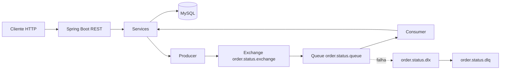

# Order Flow

API REST para gerenciamento de produtos e pedidos, com atualização de status
processada de forma assíncrona por RabbitMQ. O projeto usa Spring Boot, JPA,
Liquibase e MySQL e, atualmente, pode ser executado localmente com os serviços
de infraestrutura fornecidos pelo Docker Compose.

> **Estado atual:** a API e o processamento assíncrono estão implementados. A
> implantação em AWS e a imagem Docker da aplicação ainda não fazem parte do
> repositório.

## Sumário

- [Funcionalidades](#funcionalidades)
- [Arquitetura](#arquitetura)
- [Tecnologias](#tecnologias)
- [Pré-requisitos](#pré-requisitos)
- [Configuração](#configuração)
- [Executando localmente](#executando-localmente)
- [API](#api)
- [Mensageria e processamento assíncrono](#mensageria-e-processamento-assíncrono)
- [Persistência e migrações](#persistência-e-migrações)
- [Testes](#testes)
- [Estrutura do projeto](#estrutura-do-projeto)
- [Próximos passos](#próximos-passos)

## Funcionalidades

- Cadastro individual e em lote de produtos.
- Busca de produto por SKU ou nome e listagem de produtos.
- Atualização dos dados e do status do produto (`ENABLED` ou `DISABLED`).
- Criação de pedidos com um ou mais itens.
- Consulta de pedido por UUID e listagem de pedidos.
- Inclusão, alteração e remoção de itens enquanto o pedido está `PENDING`.
- Alteração assíncrona do status do pedido.
- Validação de produtos, quantidades, SKUs duplicados e transições de status.
- Registro de logs estruturados de sucesso e erro em banco de dados; eventos de
  sucesso são persistidos após o commit da transação.
- Processamento idempotente de eventos por meio da tabela `processed_events`.
- Retry de falhas transitórias do consumidor RabbitMQ, com rejeição sem requeue
  quando as tentativas se esgotam.
- Documentação OpenAPI/Swagger e health check via Actuator.

### Status do domínio

| Domínio | Valores |
|---|---|
| Produto | `ENABLED`, `DISABLED` |
| Pedido | `PENDING`, `PROCESSING`, `COMPLETED`, `CANCELLED` |

As transições permitidas para pedidos são:

```text
PENDING    -> PROCESSING ou CANCELLED
PROCESSING -> COMPLETED ou CANCELLED
COMPLETED  -> (final)
CANCELLED  -> (final)
```

## Arquitetura



A solicitação de mudança de status valida a transição, publica um evento e
retorna `202 Accepted`; o pedido só é alterado quando o consumidor processa a
mensagem. Cada evento possui um `eventId` UUID. A persistência desse identificador
impede efeitos duplicados em reentregas.

## Tecnologias

- Java 17
- Spring Boot 4.1.2
- Spring Web MVC e Bean Validation
- Spring Data JPA / Hibernate
- Spring AMQP / RabbitMQ
- MySQL
- Liquibase
- Springdoc OpenAPI
- Spring Boot Actuator
- Maven Wrapper
- JUnit 5, Mockito e AssertJ
- Docker Compose (MySQL e RabbitMQ)

## Pré-requisitos

- JDK 17
- Docker e Docker Compose
- Maven não é necessário: o projeto inclui `./mvnw`

## Configuração

Os arquivos de configuração estão em `src/main/resources`:

| Perfil | Banco padrão | RabbitMQ padrão | Swagger |
|---|---|---|---|
| `dev` | `jdbc:mysql://localhost:3306/orderflow` | `localhost:5672` | habilitado |
| `test` | `jdbc:mysql://localhost:3306/orderflow_test` | `localhost:5672` | habilitado |
| `prod` | obrigatório via `DB_URL` | obrigatório via `RABBITMQ_HOST` | desabilitado |

O perfil de desenvolvimento usa os seguintes valores padrão:

```text
DB_USERNAME=orderflow
DB_PASSWORD=orderflow
RABBITMQ_USERNAME=orderflow
RABBITMQ_PASSWORD=orderflowdev
```

Em produção, defina explicitamente:

```text
DB_URL
DB_USERNAME
DB_PASSWORD
RABBITMQ_HOST
RABBITMQ_PORT       # opcional; padrão 5672
RABBITMQ_USERNAME
RABBITMQ_PASSWORD
```

O Hibernate usa `ddl-auto=validate`; a estrutura do banco é controlada pelo
Liquibase.

## Executando localmente

1. Suba MySQL e RabbitMQ:

   ```bash
   docker compose -f src/main/resources/docker/docker-compose.yml up -d
   ```

2. Inicie a API com o perfil `dev`:

   ```bash
   ./mvnw spring-boot:run -Dspring-boot.run.profiles=dev
   ```

   Alternativamente:

   ```bash
   SPRING_PROFILES_ACTIVE=dev ./mvnw spring-boot:run
   ```

3. Acesse:

   - API: `http://localhost:8080`
   - Swagger UI: `http://localhost:8080/swagger-ui.html`
   - OpenAPI JSON: `http://localhost:8080/v3/api-docs`
   - Health check: `http://localhost:8080/actuator/health`
   - Console RabbitMQ: `http://localhost:15672`

   A console usa `orderflow` / `orderflowdev`, conforme o Compose.

Para encerrar os serviços:

```bash
docker compose -f src/main/resources/docker/docker-compose.yml down
```

Para remover também os dados persistidos:

```bash
docker compose -f src/main/resources/docker/docker-compose.yml down -v
```

## API

Todos os endpoints retornam um envelope no formato:

```json
{
  "data": {},
  "statusCode": 200,
  "message": "Mensagem da operação"
}
```

Os identificadores de produtos, pedidos e itens são UUIDs.

### Produtos

| Método | Endpoint | Descrição | Sucesso |
|---|---|---|---|
| `POST` | `/product/createProduct` | Cria um produto | `201 Created` |
| `POST` | `/product/createProductList` | Cria produtos em lote | `201 Created` |
| `GET` | `/product/searchProduct?sku=...` | Busca por SKU | `200 OK` |
| `GET` | `/product/searchProduct?name=...` | Busca por nome | `200 OK` |
| `GET` | `/product/listProduct` | Lista produtos | `200 OK` |
| `PUT` | `/product/updateProduct/{id}` | Atualiza nome, SKU, descrição e preço | `200 OK` |
| `PATCH` | `/product/updateProductStatus/{id}` | Atualiza `ENABLED`/`DISABLED` | `200 OK` |
| `DELETE` | `/product/removeProduct/{id}` | Remove um produto | `200 OK` |

Payload de produto:

```json
{
  "name": "Ração Premium",
  "sku": "RACAO-10KG",
  "description": "Saco de 10 kg",
  "price": 189.90
}
```

### Pedidos

| Método | Endpoint | Descrição | Sucesso |
|---|---|---|---|
| `POST` | `/orders/createOrders` | Cria pedido com itens | `201 Created` |
| `GET` | `/orders/getOrderById/{ordersId}` | Consulta pedido | `200 OK` |
| `GET` | `/orders/getListOrders` | Lista pedidos | `200 OK` |
| `GET` | `/orders/addOrderItem/{ordersId}` | Adiciona item ao pedido (payload JSON no body) | `201 Created` |
| `PATCH` | `/orders/updateOrderItem/{ordersId}/items/{itemId}` | Atualiza quantidade | `200 OK` |
| `DELETE` | `/orders/removeOrderItem/{ordersId}/items/{itemId}` | Remove item | `200 OK` |
| `PATCH` | `/orders/updateOrderStatus/{ordersId}/status` | Solicita mudança assíncrona | `202 Accepted` |

Criação de pedido:

```json
{
  "items": [
    {
      "productId": "00000000-0000-0000-0000-000000000000",
      "quantity": 2
    }
  ]
}
```

Solicitação de status:

```json
{
  "orderStatus": "PROCESSING"
}
```

Exemplo de fluxo com `curl`:

```bash
curl -X POST http://localhost:8080/product/createProduct \
  -H 'Content-Type: application/json' \
  -d '{"name":"Ração Premium","sku":"RACAO-10KG","description":"Saco de 10 kg","price":189.90}'

curl http://localhost:8080/product/listProduct

curl -X POST http://localhost:8080/orders/createOrders \
  -H 'Content-Type: application/json' \
  -d '{"items":[{"productId":"<PRODUCT_UUID>","quantity":2}]}'

curl -X PATCH http://localhost:8080/orders/updateOrderStatus/<ORDER_UUID>/status \
  -H 'Content-Type: application/json' \
  -d '{"orderStatus":"PROCESSING"}'

curl http://localhost:8080/orders/getOrderById/<ORDER_UUID>
```

Erros de validação, recursos inexistentes, conflitos de transição e falhas
internas são devolvidos no mesmo envelope, com `data: null`.

## Mensageria e processamento assíncrono

O RabbitMQ é configurado com:

| Recurso | Nome |
|---|---|
| Exchange principal | `order.status.exchange` |
| Routing key | `order.status.updated` |
| Fila principal | `order.status.queue` |
| Dead-letter exchange | `order.status.dlx` |
| Dead-letter queue | `order.status.dlq` |
| Routing key de falha | `order.status.failed` |

O evento publicado contém `eventId`, `orderId` e `newStatus`. O consumidor usa
retry stateless para falhas transitórias (até três retries adicionais, com
backoff exponencial limitado a 10 segundos). Falhas de regra de negócio não
são repetidas. Com `AcknowledgeMode.AUTO` e `defaultRequeueRejected=false`,
uma mensagem rejeitada não é recolocada na fila; a configuração da fila
direciona mensagens rejeitadas para a DLQ.

## Persistência e migrações

As entidades principais são:

- `product`: produto, SKU único, status, preço e timestamps.
- `orders`: pedido, data, status e timestamps.
- `order_items`: produtos do pedido, quantidade, preço unitário e subtotal.
- `application_logs`: logs estruturados de operações.
- `processed_events`: IDs de eventos já processados e timestamp.

As migrações ficam em `src/main/resources/db/changelog` e são incluídas por
`master.xml`. O Liquibase é executado na inicialização com o perfil habilitado.

## Testes

Execute a suíte com:

```bash
./mvnw test
```

Os testes cobrem o carregamento do contexto, regras de pedidos, publicação e
consumo de eventos RabbitMQ e configuração do listener.

## Estrutura do projeto

```text
src/
├── main/java/com/backend/orderflow/
│   ├── controller/       # endpoints REST
│   ├── domain/           # entidades e enums
│   ├── dto/              # requests e responses
│   ├── mapper/           # conversão de entidades
│   ├── repository/       # Spring Data JPA
│   ├── service/          # regras de negócio
│   └── utils/
│       ├── ApiResponse/  # envelope de resposta
│       ├── Logger/       # logging de aplicação
│       ├── Rabbitmq/     # producer, consumer e configuração
│       └── SwaggerConfig/
├── main/resources/
│   ├── application*.yaml
│   ├── db/changelog/
│   └── docker/docker-compose.yml
└── test/java/            # testes unitários e de contexto
```

## Próximos passos

- Criar uma imagem Docker da aplicação e incluí-la no Compose.
- Automatizar build, testes e publicação da imagem em CI/CD.
- Definir a infraestrutura de produção na AWS (por exemplo, ECS, RDS,
  Amazon MQ, ECR, Secrets Manager e CloudWatch).
- Avaliar autenticação/autorização e versionamento público da API.
